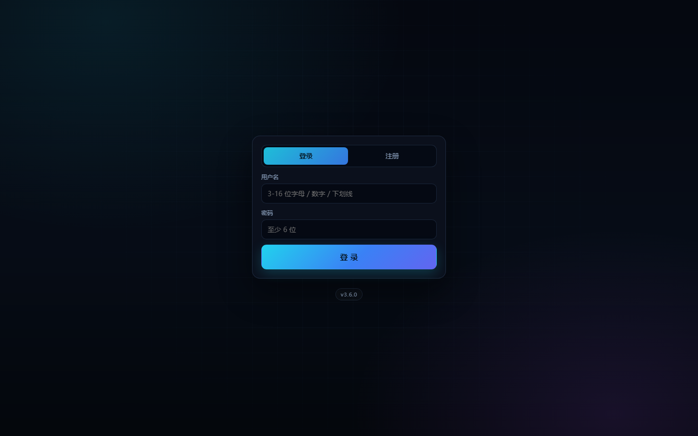
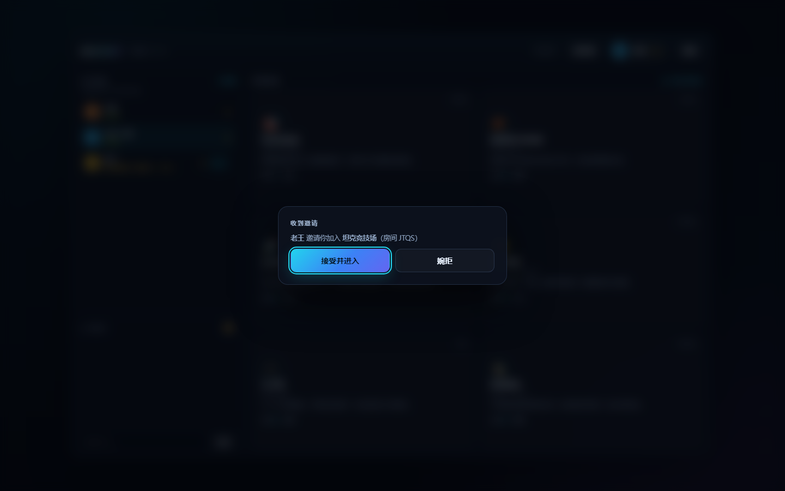
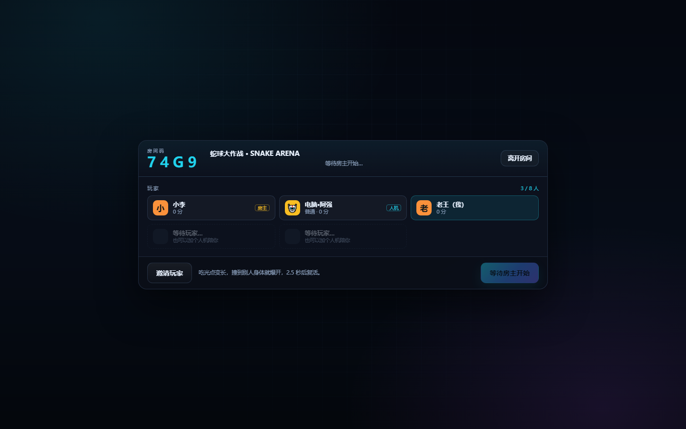
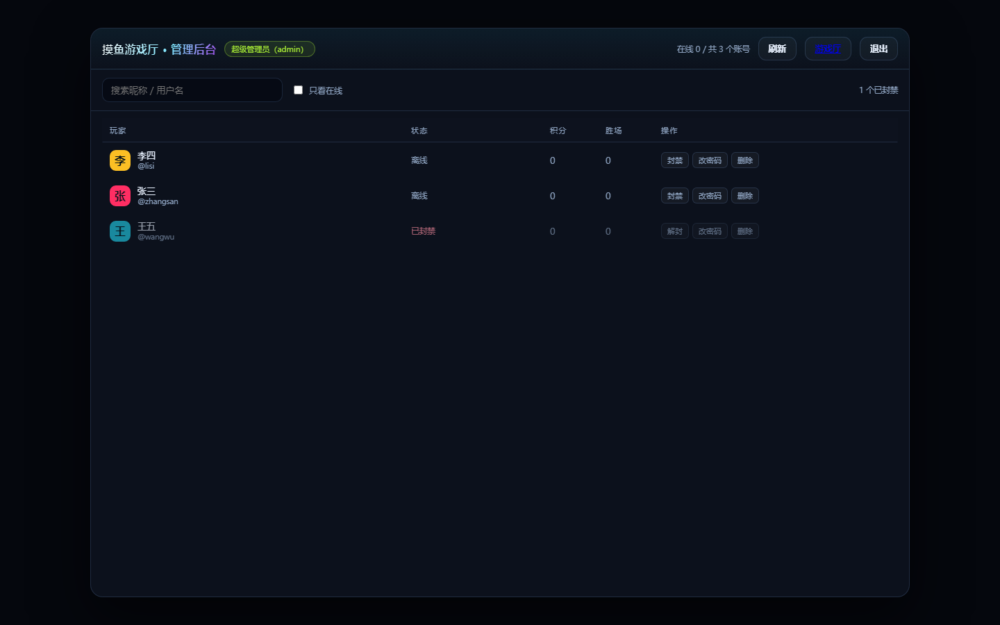
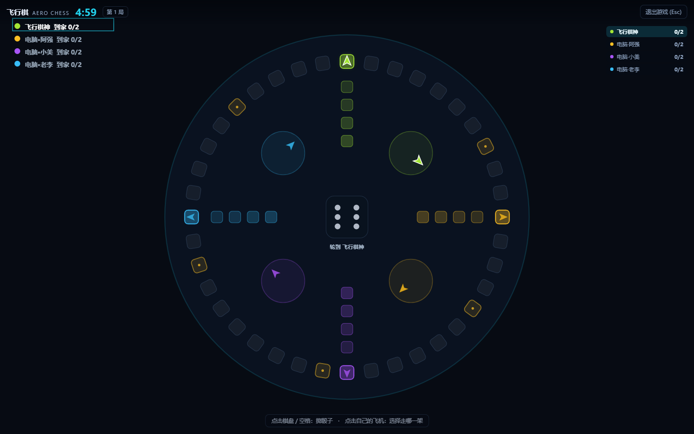
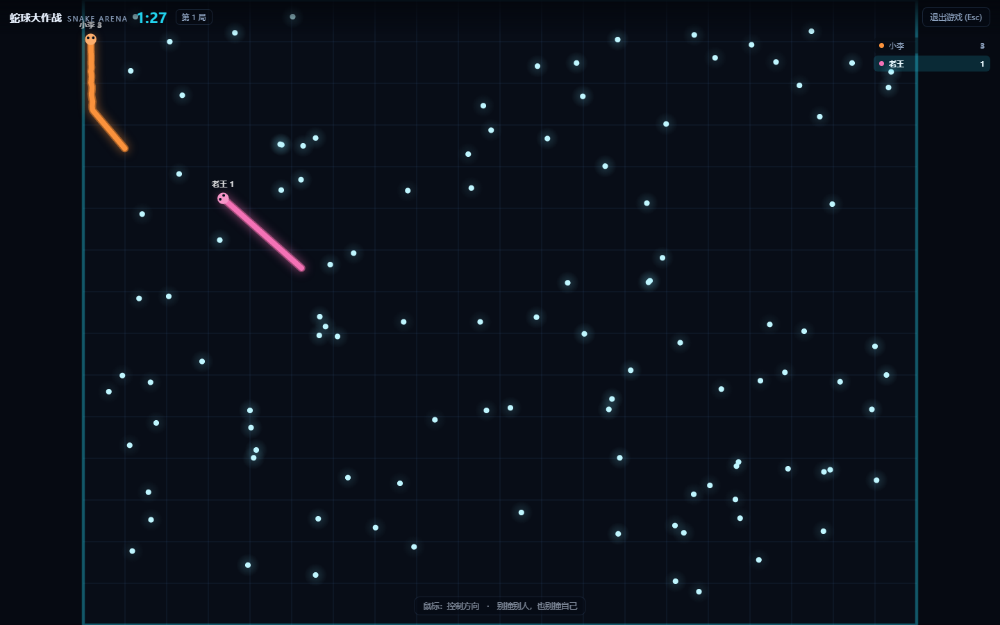
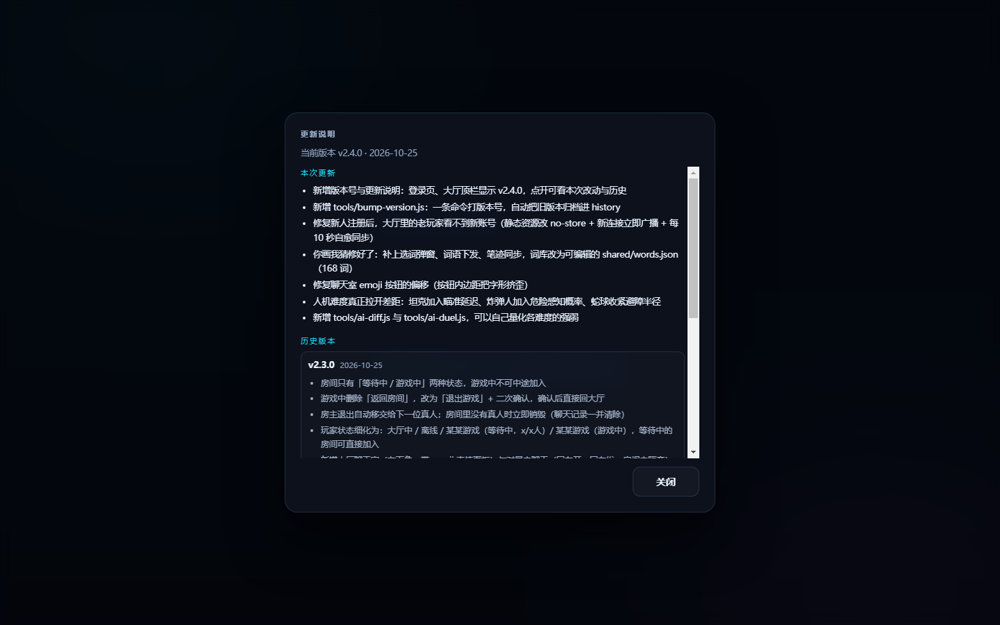

# 摸鱼游戏厅 · OFFICE ARCADE v2

内网里的小游戏平台：**注册登录 → 大厅看到谁在线 → 挑个游戏进分区 → 建房/邀请同事 → 开玩**。
七款小游戏共用一个账号、一套在线状态和一份战绩榜，全部数据落在服务器本地。
没人的时候可以**加人机**，一个人也能开局。

- 零 npm 依赖：Node 自带 `node:sqlite` + 手写 WebSocket
- 服务端权威：成绩由服务器算，改前端没用
- 数据本地：`data/arcade.sqlite` 一个文件，复制即备份


---

## 零、两种使用方式

这个仓库里**只有开发源码**——没有 Node 运行时，也没有现成的安装包。

### A. 我只想玩

去 [发行版](https://gitee.com/th1nker/office-arcade/releases) 下载对应平台的包，解压、双击启动，全程不碰 git：

| 平台 | 包名 | 启动方式 |
| --- | --- | --- |
| Windows x64 | `office-arcade-v<版本>-win-x64.zip` | 双击 `启动游戏厅.bat` |
| Linux x64 | `office-arcade-v<版本>-linux-x64.tar.gz` | `./start.sh` |
| macOS (Apple Silicon) | `office-arcade-v<版本>-darwin-arm64.tar.gz` | 双击 `start.command`，或 `./start.sh` |

每个包自带该平台的 Node 运行时和一份**随机密码**的 `admins.json`，解压即用。
`dist/SHA256SUMS.txt` 里有各包的校验值。

### B. 我要改代码

```bash
git clone https://gitee.com/th1nker/office-arcade.git
cd office-arcade

# 1) 拉一份本机 Node 运行时到 runtime\（约 90 MB，只下一次，不入库）
#    Windows 双击「获取运行环境.bat」，或：
powershell -ExecutionPolicy Bypass -File tools/fetch-runtime.ps1

# 2) 管理员账号
cp admins.example.json admins.json

# 3) 启动
runtime/node.exe server.js            # Windows
node server.js                        # 有系统 Node 时也行（≥ 22.5 才有 SQLite）
```

`data/`（玩家数据库）同样不入库；换机器时把旧的 `data/arcade.sqlite` 拷过来即可。

### C. 发版

发版是**六步**，顺序不能乱（尤其第 4 步要在第 5 步之前，否则 tag 会指到旧提交）：

> 详细版（含改哪里、验证、各种翻车抢救）见 **[docs/发版流程.md](docs/发版流程.md)**。

```bash
# 1) 跑测试
node tools/game-test.js && node tools/bot-test.js
node tools/auth-test.js && node tools/admin-test.js

# 2) 打版本号：旧版本自动归档进 version.json 的 history
runtime\node.exe tools\bump-version.js 2.8.0 "这次改了什么" "还改了什么"

# 3) 提交
git add -A
git commit -m "feat: ..."

# 4) 先推送（远程 main 必须包含这个提交）
git push

# 5) 构建 + 发布（脚本会自动建发行版、上传三个包）
$env:GITEE_TOKEN="你的私人令牌"
powershell -ExecutionPolicy Bypass -File tools\publish-release.ps1

# 6) 把发行版自动创建的 tag 同步到本地
git fetch --tags
```

`publish-release.ps1` 内置保护：如果 `HEAD` 和 `origin/main` 不一致会直接报错，避免发行版的 tag 打在旧提交上。

首次发版前需要一次性准备（约 230 MB 下载）：

```bash
powershell -ExecutionPolicy Bypass -File tools\fetch-runtime.ps1 -Target win-x64,linux-x64,darwin-arm64
```

Unix 包用 python 的 `tarfile` 打包以保留可执行位；没有 python 时退回 `tar.exe`（解压后需 `chmod +x`，`start.sh` 也会自愈）。

## 一、快速开始

发行版自带 Node 运行时（`runtime\node.exe`），**不需要系统里装 Node，也不会去 PATH 里找**。

发行包分两种，只有数据放哪不一样：

| | 数据位置 | 适合 |
| --- | --- | --- |
| **标准版** | Windows `%APPDATA%\office-arcade`、macOS `~/Library/Application Support/office-arcade`、Linux `~/.local/share/office-arcade` | 正常安装，数据不随程序目录走 |
| **便携版** | 软件目录下的 `data\` | 放 U 盘、不想在系统里留痕、整个文件夹拷走就搬家 |

启动横幅会打印实际用的目录：`数据位置： 标准版 · C:\Users\xxx\AppData\Roaming\office-arcade`

1. 双击 **`启动游戏厅.bat`**。
2. 终端打印：

   ```
   本机浏览器： http://localhost:8090
   局域网访问： http://192.168.1.23:8090
   ```

3. 同事用浏览器打开 → **注册**（用户名 + 密码 + 昵称）→ 进入大厅。
4. 在大厅左侧能看到所有人的状态：`在线` / `在玩 蛇球大作战` / `离线`。
5. 点一张游戏卡片进入分区 → `创建房间` 或输入房间码加入。
6. 房间里点 **邀请玩家**，选一个在线同事，对方会收到弹窗，接受即进房。
7. 房主点 **开始游戏**。



> 从源码跑的话：先双击 **`获取运行环境.bat`** 下载一次运行时（约 90 MB），之后完全离线。
> 手动启动：`runtime\node.exe server.js`（换端口就加参数，例如 `runtime\node.exe server.js 8091`）。
> 防火墙需放行对应端口（首次运行会弹窗，选「允许」）。

**关于 Node 版本**：自带的是 Node 24.21.0（内置 `node:sqlite`）。想换版本时把别处的 `node.exe`
覆盖到 `runtime\` 即可；18/20 也能跑，会自动回退 JSON 存储。

## 二、账号与资料

| 功能 | 说明 |
| --- | --- |
| 注册 | 用户名 3-16 位字母/数字/下划线，密码 ≥ 6 位，昵称 1-10 字 |
| 登录 | 会话保存在 HttpOnly Cookie 里，7 天有效，WebSocket 复用同一会话 |
| 个人资料 | 昵称、签名、20 个 emoji 头像、12 种颜色；修改后立刻同步到房间与大厅 |
| 修改密码 | 需要验证原密码 |
| 战绩 | 积分 / 胜场 / 总局数 / 最高连胜 + 最近 20 局明细 |


---

## 三、大厅与房间

**玩家状态**（大厅左侧实时刷新）：

| 状态 | 显示 | 能做什么 |
| --- | --- | --- |
| 在线 | `在线` | 可以邀请 |
| 等待中 | `蛇球大作战（等待中）` | 旁边有「加入」按钮，一键进房 |
| 游戏中 | `蛇球大作战（房间中 2/8）` | 中途不能加入，等下一局 |
| 离线 | `离线` | — |

**房间生命周期**：

- 房间只有两种状态：**等待中** / **游戏中**；游戏中不接受新玩家，也没有观战
- 游戏中只有「退出游戏」，点了会**二次确认**，确认后直接回大厅
- 退出后房间保留原状；如果退出的是房主，房主自动移交给下一位**真人**（不会交给电脑）
- 房间内**一个真人都没有**时（不论等待还是游戏中），房间立即销毁，聊天记录一起清掉

**邀请**：把房间码发给同事，或点「邀请玩家」选在线同事。

**聊天**：

- **大厅聊天**（左下角）：所有人都能发言，支持 emoji 表情面板，新上线的人能看到最近 50 条
- **对局聊天**：按 `Enter` 展开输入框，再按 `Enter` 发送，`Esc` 收起；
  与游戏热键（WASD / 方向键 / 空格 / 鼠标）互不冲突，消息只在当前房间内可见，房间销毁即消失
- 你画我猜里，对局聊天同时就是答题框：猜对了不会把原话广播出去




---

## 四、六款游戏

| 游戏 | 人数 | 一局 | 玩法 |
| --- | --- | --- | --- |
| 🐍 蛇球大作战 | 1-8 | 90 秒 | 鼠标转向吃光点变长，撞到别人身体就爆开，2.5 秒复活；撞自己不死，可以盘成麻花 |
| 🎯 坦克竞技场 | 2-8 | 150 秒 | WASD + 鼠标瞄准，砖墙可打穿，3 血重生；**复活 1 秒无敌（闪烁）**，地图随机刷 4 种补给 |
| 💣 炸弹人 | 2-4 | 120 秒 | 放炸弹拆砖块，掉落加炸弹/加范围/加速度道具，最后活着的人赢 |
| 🧱 俄罗斯方块对战 | 2-4 | 180 秒 | 消行给对手塞垃圾行，顶死出局 |
| 🚀 合作弹幕 | 1-4 | 120 秒 | 全队打波次 + BOSS；**自动开火**，**分数按各自击毁数独立结算**；Boss 登场先开火才解除无敌 |
| 🎨 你画我猜 | 2-10 | 每轮 60 秒 | 轮流作画，其他人抢答；**三档难度可选**，每 10 秒放一条提示，画手可一键**清空画布**，全员猜中立刻下一轮，答对的话在别人那里显示成 *** |
| 🏎️ 极速环线 | 2-8 | 150 秒 | 俯视漂移赛车，4 条赛道 2 圈，先冲线者赢 |
| ✈️ 飞行棋 | 2-4 | 300 秒 | 40 格环 + 4 格归航道，每人 2 架；踩到对手送回起点，两架先到家者胜 |

计分：每局按名次给 **+5 / +3 / +1**，累计进数据库；连续第一累积「连胜」，输一局清零。

### 人机

房间里点 **+ 人机** 就能补一个电脑玩家，难度四档：**简单 / 普通 / 困难 / 变态**。

- 除「你画我猜」外，六款游戏都有人机 AI（赛车、蛇球、坦克、炸弹人、俄罗斯方块、弹幕）
- 人机是服务端权威模拟，和真人走同一套 `input / tick` 流程，战绩不进排行榜
- 一个人 + 三个人机就能开局，等人时也不至于干坐着


## 三之二、管理后台

浏览器打开 **`http://<服务器>:8090/admin.html`**，用管理员账号登录。

账号写在根目录 **`admins.json`**（明文，改完重启服务器生效）：

```json
{
  "admins": [
    { "username": "admin", "password": "admin888", "name": "超级管理员" }
  ]
}
```

能做的事：

| 功能 | 说明 |
| --- | --- |
| 用户列表 + 搜索 | 昵称/用户名/积分/胜场/在线状态/所在房间，支持按昵称或用户名搜索、只看在线 |
| 封禁 / 解封 | 封禁后无法登录，也连不上 WebSocket；在线的人当场被踢下线 |
| 强制下线 | 直接断开某人的连接（下次还能登录） |
| 踢出房间 | 把人从当前房间移回大厅，房间其他人不受影响 |
| 重置密码 | 给某人设一个新密码，页面上会显示出来方便转告 |
| 删除账号 | 需要手动输入对方昵称确认，账号与战绩一并删除 |

管理员用的是独立会话（`asid` cookie），和普通用户账号完全隔离；管理接口在未登录时一律 401。



### 人机难度对照

四档难度用的都是同一套代码，靠 `BOT_SKILL`（0.3 ~ 1.0）和各自的行为参数拉开差距：

| 游戏 | 难度带来了什么变化 |
| --- | --- |
| 🐍 蛇球 | 避障半径 88→150px、方向抖动 ±0.62→0 rad；低难度经常一头扎进别人身体 |
| 🎯 坦克 | 瞄准更新间隔 0.47s→0.14s（低难度打移动目标会打在旧位置上）、抖动 ±0.08→±0.005 rad、只有困难以上才会边打边走位，简单难度会站桩挨打；所有难度都不会隔石墙开火，砖墙会主动打穿 |
| 💣 炸弹人 | 危险感知概率 62%→98%（简单难度经常没注意到脚下的炸弹）、简单会无目标乱放弹 |
| 🧱 方块 | 操作间隔 0.22s→0.04s，选点从前 4 名随机 → 直接取最优；90 秒消行 16 → 171 |
| 🚀 弹幕 | 躲弹半径 123→197px、站位摆动 ±49→±2px；所有人都会分道、互相避让、预判 0.2s 的子弹 |
| 🏎️ 赛车 | 极速上限 0.74→1.0 倍、转向噪声 0.22→0；2 圈用时 76s → 62s |
| ✈️ 飞行棋 | 选点从"前 N 名随机"→"踩人 > 到家 > 安全格 > 走得远"的完整评估，简单难度有小概率手滑 |
| 🎨 画猜 | 没有人机 |

> 说明：自由混战类（坦克/蛇球/弹幕）里总分是零和的，难度差异更多体现在**活得更久、打得更准**，而不是分数翻倍。
> 想自己看数字：`runtime\node.exe tools\ai-diff.js`（难度横扫）和 `tools\ai-duel.js`（1v1 对照）。





---

## 四之三、几个细节

### 颜色与身份

- **房间里每个人颜色都不一样**：进房时从调色板里挑一个还没被占用的颜色，不再用个人资料里的颜色（那样容易撞色）
- **自己的名字永远是绿色**：HUD 右侧排行、结算表、房间玩家列表都一样

### 击杀播报

坦克、炸弹人、蛇球、弹幕击毁对手时，屏幕上方会滚出一条 `玩家A 击毁 玩家B`。
飞行棋用同一套播报：`玩家A 掷出 5 点`、`玩家A 撞回 玩家B`、`起飞`、`到家`。

### 结算里的绿色小标签

结算表名字后面的标签是**本局击杀数**（飞行棋是「到家」数），例如 `张三 击杀 3`。

### 坦克的四种补给

地图上每 10 秒左右随机刷一个，走过去自动吃，最多同时存在 3 个：

| 补给 | 图标 | 效果 |
| --- | --- | --- |
| 加速 | ⚡ | 移动速度 ×1.35，持续 8 秒 |
| 连发 | 🔥 | 射击间隔 ×0.55，持续 8 秒 |
| 护盾 | 🛡 | 抵挡 1 次伤害（最多叠 2 层） |
| 修护 | ✚ | 立刻恢复 2 点耐久 |

## 五、数据与持久化

选择的是 **SQLite（`node:sqlite`）**，旧版本 Node 自动回退到 JSON 存储。

| Node 版本 | 存储 | 说明 |
| --- | --- | --- |
| 24.x（实测 24.21） | SQLite | 直接可用 |
| 22.13+（实测 22.20） | SQLite | 直接可用，启动时可能打一条 ExperimentalWarning |
| 22.5 – 22.12 | SQLite（需 `--experimental-sqlite`） | 不加 flag 就回退 JSON，不会报错 |
| 18 – 22.4（实测 18.20） | JSON | 自动回退，功能一致 |

**推荐 Node 22.5+（最好直接装 24 LTS）**；只有 JSON 存储时也够几十人的办公室用。

```
data/arcade.sqlite     (或 data/arcade.json)
```

表结构：

```sql
users(id, username UNIQUE, pass_hash, salt, nickname, color, avatar, bio,
      points, wins, rounds, streak, best_streak, created_at, last_login)
sessions(token, user_id, created_at, expires_at)
matches(id, game, room_code, started_at, ended_at)
match_players(match_id, user_id, place, score, delta, detail)
```

- 密码用 `scrypt` + 随机盐哈希，**不存明文**
- 一局结束写一条 `matches` + 每人一条 `match_players`，并在同一事务里更新积分/胜场/连胜
- 在线状态、房间、邀请**只在内存**（重启即清，符合语义）
- 备份：停服后复制 `data/arcade.sqlite` 即可

强制使用 JSON 存储（例如 Node < 22.5）：

```bash
set ARCADE_STORE=json && node server.js      # Windows
ARCADE_STORE=json node server.js             # macOS / Linux
```

换目录：`set ARCADE_DATA=D:\arcade-data && node server.js`。

---

## 五之二、你画我猜词库与难度

词库是独立文件 **`shared/words.json`**，按难度分三组，每组 100 个词，每个词带 3 条递进提示：

```json
{
  "version": 2,
  "levels": {
    "easy":   { "name": "简单", "words": [
      { "w": "苹果", "h": ["一种水果", "红色或绿色", "咬一口很脆"] }
    ] },
    "normal": { "name": "中等", "words": [ ... ] },
    "hard":   { "name": "困难", "words": [ ... ] }
  }
}
```

### 难度怎么选

房间里有一个「关键词难度」选择器，**房主开局前点一下**就切，其他人实时看到同一个难度：

| 难度 | 词的样子 | 例子 |
| --- | --- | --- |
| 简单 | 水果、动物、日用品，看得见摸得着 | 苹果 · 猫 · 雨伞 |
| 中等 | 职业、场所、动作、场景，要一点联想 | 医生 · 摩天轮 · 刷牙 |
| 困难 | 成语、抽象概念、科普与网络热词 | 画蛇添足 · 孤独 · 量子纠缠 |

### 提示怎么放

作画阶段一共 60 秒，从第 10 秒起**每 10 秒放出一条提示**，第 30 秒放完 3 条：

```
00s  开始作画
10s  提示 1
20s  提示 2
30s  提示 3
60s  本轮结束（或全员猜中提前结束）
```

提示条显示在画布下方，带序号和下一条的倒计时；画手自己能看到词，所以不显示提示条。

### 画错了怎么办

画手在作画阶段，右上角有一个 **「清空画布」** 按钮（红色描边），点一下整块画布立刻清空，**所有人同步**——不用等换轮。
非画手看不到这个按钮，服务端也只接受画手的清空指令。

### 改词库

- 直接编辑 `shared/words.json`，保存后**重启服务器**生效
- 提示越往后越接近答案，别把答案本身写进提示里
- 单个词最多 16 个字；提示最多 3 条，多写的会被忽略
- 文件缺失或格式错误时回退到内置词库，并在启动日志里提示
- 启动横幅会打印各难度词条数：`画猜词库： 简单 100 / 中等 100 / 困难 100`

老格式（`{"words": ["苹果", ...]}`）仍然能读，会当作中等难度使用。

## 五之三、版本与更新说明

版本信息放在根目录 **`version.json`**：

```json
{
  "version": "2.4.0",
  "released": "2026-10-25",
  "notes": ["这次改了什么", "..."],
  "history": [
    { "version": "2.3.0", "released": "2026-10-25", "notes": ["..."] }
  ]
}
```

改完代码后打一个新版本：

```bash
runtime\node.exe tools\bump-version.js 2.5.0 "修了 A" "加了 B"
```

它会把当前版本自动归档进 `history`、写入新版本号和日期、顺手同步 `package.json` 的 version。
也可以先看看现在是什么版本：`runtime\node.exe tools\bump-version.js --show`。

页面上的入口：

- **登录页底部**：`v2.4.0`，点开就是更新说明
- **大厅顶栏**：`v2.4.0`，点开同上（含历史版本）
- **浏览器标签标题**：`摸鱼游戏厅 v2.4.0`
- **启动横幅**：`版本： v2.4.0（2026-10-25） · 7 条更新说明`



## 六、接口一览

| 方法 | 路径 | 说明 |
| --- | --- | --- |
| POST | `/api/register` | 注册（返回 Cookie） |
| POST | `/api/login` | 登录 |
| POST | `/api/logout` | 退出 |
| GET | `/api/me` | 当前用户 |
| POST | `/api/profile` | 改昵称/头像/颜色/签名 |
| POST | `/api/password` | 改密码 |
| GET | `/api/history?limit=20` | 我的对局明细 |
| GET | `/api/version` | 当前版本与更新说明（公开） |
| GET | `/api/board` | 排行榜（公开） |
| GET | `/api/rooms?game=snake` | 某游戏的可加入房间 |

WebSocket（`/ws`，用同一 Cookie 鉴权）承载：大厅广播、房间、开局、输入、快照、邀请。

---

## 七、技术架构

```
浏览器 ──HTTP(账号/资料/历史)──▶ Node 服务器 ──▶ SQLite
   └────WebSocket(大厅/房间/邀请/对局)────┘
```

- **服务端权威**：`shared/games/*.js` 同时被 Node 加载执行、被浏览器加载读元信息；客户端只发输入、画快照
- **大厅广播**：任何在线/进入房间/改名都会触发一次合并广播（80ms 合并，避免刷屏）
- **房间**：4 位码、人数上限按游戏配置、房主离开自动移交
- **邀请**：60 秒有效，被邀请方在线且不在房间才可被邀请
- **对局**：60Hz 固定步长模拟，30Hz（棋盘类 15Hz）广播快照

### 目录结构

```
office-arcade/
├── index.html              登录 / 大厅 / 分区 / 房间 / 资料 / HUD
├── css/style.css
├── shared/
│   ├── core.js  registry.js
│   ├── store.js  store-sqlite.js  store-json.js
│   └── games/              六款游戏的服务端权威模拟
├── js/
│   ├── net.js  audio.js  input.js  render.js  ui.js  main.js
├── server.js               HTTP + WebSocket + 账号 + 房间 + 邀请
├── docs/发版流程.md         从拉代码到发版的完整流程
├── tools/                  测试脚本 + 构建/发版脚本 + runtime-manifest.json
├── start.sh / start.command  Linux / macOS 启动器
├── runtime/node.exe        本机 Node 运行时（不入库，获取运行环境.bat 下载）
├── version.json            版本号 + 更新说明
├── admins.json             管理员账号（明文，不入库）
├── admin.html              管理后台页面
├── data/                   数据库（不入库，自动生成）
├── 启动游戏厅.bat           Windows 启动器
└── 获取运行环境.bat         开发者用：联网下载本机 runtime\node.exe
```

---

## 八、测试

```bash
node tools/game-test.js    # 六款游戏逻辑 + 关键机制（含鼠标转向、消行、炸弹连锁）
node tools/bot-test.js     # 人机：每款游戏的无头模拟，确认人机会玩、赛车能跑完
node tools/auth-test.js    # 账号、会话、大厅状态、房间、邀请、静态资源白名单
node tools/proxy-test.js   # 反向代理 + WebSocket 升级
node tools/ui-v2-test.js   # 三个真实浏览器：注册→大厅→建房→邀请→开局→资料→排行榜
node tools/ui-v3-test.js   # 人机局：加人机→开局→赛车→HUD 圈数
node tools/ui-v4-test.js   # 鼠标控蛇回归、一键加入、大厅/对局聊天、退出二次确认
```

`ui-v2-test.js` 会自动截图到 `shots/`，并检查每个页面的 console 是否报错。

---

## 九、已知限制

- 一局进行中不能加入房间（等下一局），避免中途进场破坏平衡
- 同一账号同时只保留最新一个连接（在别处打开会把旧的顶掉）
- 仅面向桌面浏览器（鼠标瞄准、键盘操作），未做手机触屏布局
- 排行榜按账号合并，改名不影响战绩
