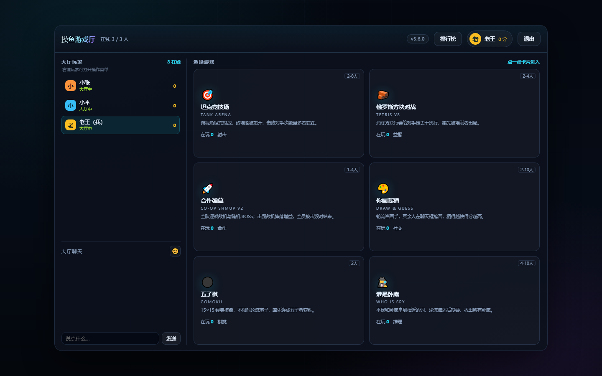
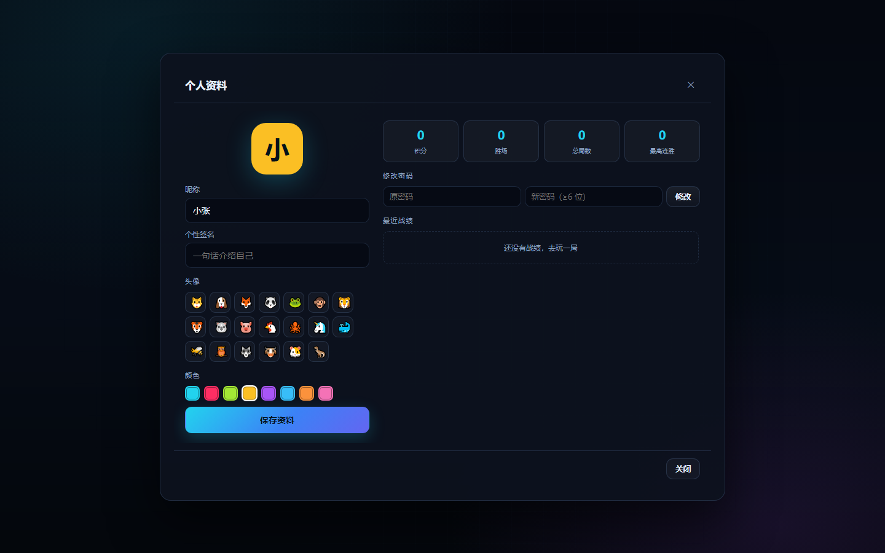
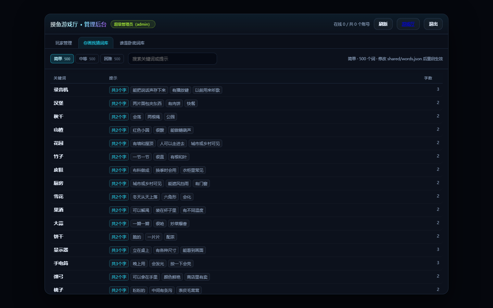
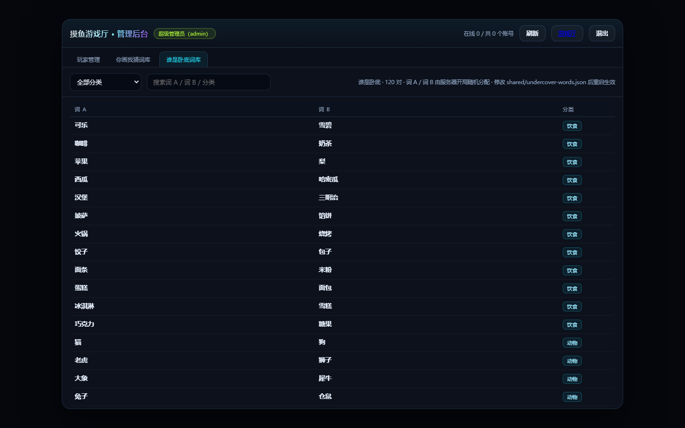
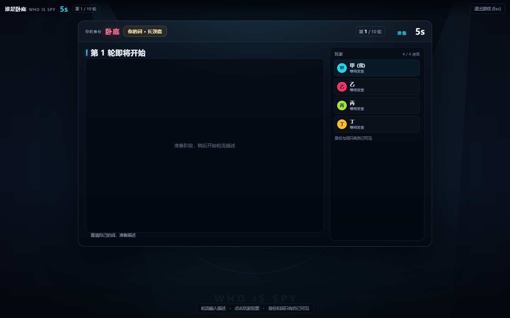
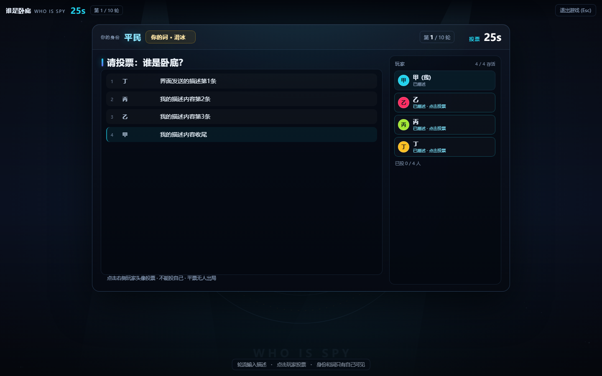
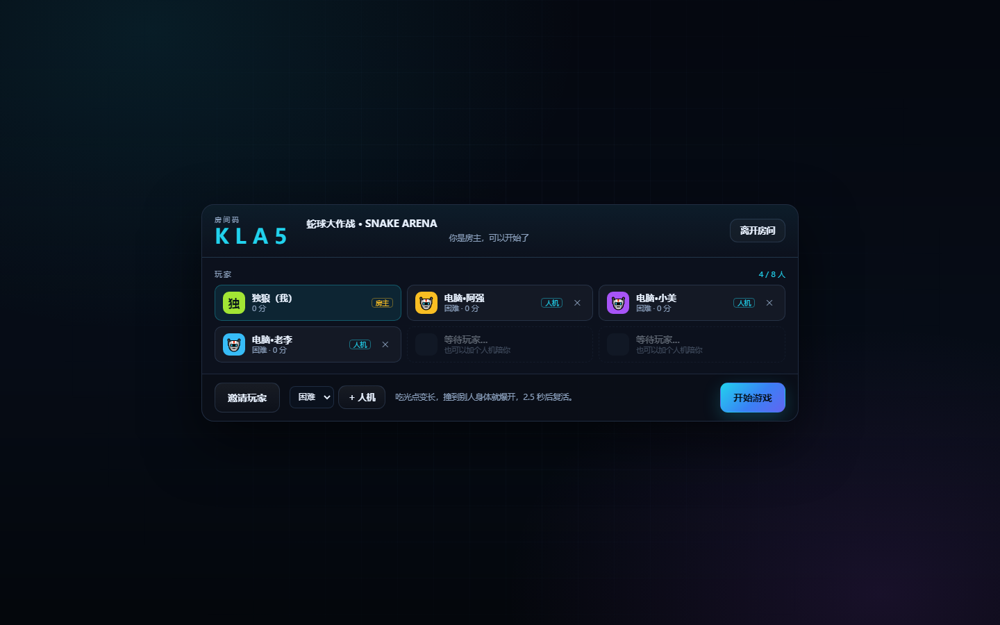
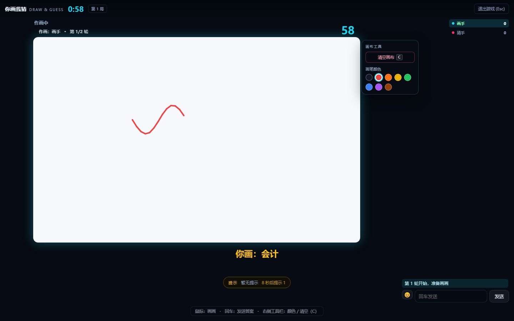

# 摸鱼游戏厅 · OFFICE ARCADE v2

内网里的小游戏平台：**注册登录 → 大厅看到谁在线 → 挑个游戏进分区 → 建房/邀请同事 → 开玩**。
六款小游戏共用一个账号、一套在线状态和一份战绩榜，全部数据落在服务器本地。
没人的时候可以**加人机**，一个人也能开局。

- 零 npm 依赖：Node 自带 `node:sqlite` + 手写 WebSocket
- 服务端权威：成绩由服务器算，改前端没用
- 数据本地：`data/arcade.sqlite` 一个文件，复制即备份



---

## 零、两种使用方式

这个仓库里**只有开发源码**——没有 Node 运行时，也没有现成的安装包。

### A. 我只想玩

去 [发行版](https://gitee.com/th1nker/office-arcade/releases) 下载对应平台的包，解压、双击启动，全程不碰 git：

| 平台 | 包名 | 启动方式 |
| --- | --- | --- |
| Windows x64 | `office-arcade-v<版本>-win-x64.zip` | 双击 `启动游戏厅.bat` |
| Linux x64 | `office-arcade-v<版本>-linux-x64.tar.gz` | `./start.sh` |
| macOS (Apple Silicon) | `office-arcade-v<版本>-darwin-arm64.tar.gz` | 双击 `start.command`，或 `./start.sh` |

每个包自带该平台的 Node 运行时和一份**随机密码**的 `admins.json`，解压即用。
`dist/SHA256SUMS.txt` 里有各包的校验值。

### B. 我要改代码

```bash
git clone https://gitee.com/th1nker/office-arcade.git
cd office-arcade

# 1) 拉一份本机 Node 运行时到 runtime\（约 90 MB，只下一次，不入库）
#    Windows 双击「获取运行环境.bat」，或：
powershell -ExecutionPolicy Bypass -File tools/fetch-runtime.ps1

# 2) 管理员账号
cp admins.example.json admins.json

# 3) 启动
runtime/node.exe server.js            # Windows
node server.js                        # 有系统 Node 时也行（≥ 22.5 才有 SQLite）
```

`data/`（玩家数据库）同样不入库；换机器时把旧的 `data/arcade.sqlite` 拷过来即可。

> 有权限的开发者也可以从 GitHub 私有镜像克隆：`git clone https://github.com/TH1nker2/office-arcade.git`。

### C. 发版

发版是**七步**，顺序不能乱（尤其第 4 步要在第 5 步之前，否则 tag 会指到旧提交）：

> 详细版（含改哪里、验证、各种翻车抢救）见 **[docs/发版流程.md](docs/发版流程.md)**。

```bash
# 1) 跑测试
node tools/words-test.js && node tools/game-test.js && node tools/bot-test.js
node tools/auth-test.js && node tools/admin-test.js && node tools/admin-words-ui-test.js

# 2) 打版本号：旧版本自动归档进 version.json 的 history
runtime\node.exe tools\bump-version.js 3.2.0 "这次改了什么" "还改了什么"

# 3) 提交
git add -A
git commit -m "feat: ..."

# 4) 先推送（远程 main 必须包含这个提交）
git push

# 5) 构建 + 发布（脚本会自动建发行版、上传三个包）
$env:GITEE_TOKEN="你的私人令牌"
powershell -ExecutionPolicy Bypass -File tools\publish-release.ps1

# 6) 把发行版自动创建的 tag 同步到本地
git fetch --tags

# 7) 同步 GitHub 私有镜像（代码 + 本次 tag）
git push github main
git push github --tags
```

`publish-release.ps1` 内置保护：如果 `HEAD` 和 `origin/main` 不一致会直接报错，避免发行版的 tag 打在旧提交上。

GitHub 只是**私有代码镜像**（`https://github.com/TH1nker2/office-arcade.git`），发行包仍然只发 Gitee。
日常代码推送也要同步镜像：`git push` 之后再 `git push github main`；发版后再补 `git push github --tags`。

首次发版前需要一次性准备（约 230 MB 下载）：

```bash
powershell -ExecutionPolicy Bypass -File tools\fetch-runtime.ps1 -Target win-x64,linux-x64,darwin-arm64
```

Unix 包用 python 的 `tarfile` 打包以保留可执行位；没有 python 时退回 `tar.exe`（解压后需 `chmod +x`，`start.sh` 也会自愈）。

## 零之一、给开发者的入口

**要改代码、加功能、修 bug，请先读 [`docs/开发手册.md`](docs/开发手册.md)**。

手册里写了：项目架构、一次对局的完整数据流、游戏模块契约（加新游戏照抄骨架）、
存储层与迁移、前端状态机、WebSocket 协议速查、测试矩阵、发版流程，
以及历史上踩过的坑（路径穿越、批处理编码、只读数据库、快照频率等）。

这份 README 面向使用者，开发手册面向接手的开发者。

## 零之二、完全离线

这个程序是给**没有互联网的内网**用的，运行时不会访问任何外网资源：

- 页面只用本地 `css/` `js/` `shared/`，没有 CDN、没有外链字体、没有远程接口
- 所有接口都是相对路径（`/api/...`），WebSocket 地址由 `location.host` 推导
- 除了首次下载发行包，装好之后断网也能完整运行

自带一个审计脚本，会真的用浏览器打开一遍全部页面、打一局游戏，列出每一个网络请求：

```bash
node tools/offline-test.js
#   PASS 没有任何外网请求 — 全部本机
```

改动前端后建议跑一次，防止不小心引入了外链。

> 启动脚本（`.bat`）里**只用英文**：中文写在批处理里会因为控制台代码页不同被拆行，
> 报 `xxx is not recognized as an internal or external command`。中文提示由 Node 在启动横幅里输出。

## 一、快速开始

发行版自带 Node 运行时（`runtime\node.exe`），**不需要系统里装 Node，也不会去 PATH 里找**。

数据固定放在**程序目录下的 `data\`**，不写系统任何位置：

```
office-arcade\
├── 启动游戏厅.bat
├── runtime\node.exe
└── data\                  ← 账号、战绩、聊天都在这儿
    └── arcade.sqlite
```

- **备份** = 复制整个 `data` 目录
- **换机器** = 把 `data` 拷到新机器的同位置
- **重新开始** = 删掉 `data` 目录，重启即可

启动横幅会打印实际用的目录：`数据位置： D:\games\office-arcade\data`

## 二、账号与资料

| 功能 | 说明 |
| --- | --- |
| 注册 | 用户名 3-16 位字母/数字/下划线，密码 ≥ 6 位，昵称 1-10 字 |
| 登录 | 会话保存在 HttpOnly Cookie 里，7 天有效，WebSocket 复用同一会话 |
| 个人资料 | 昵称、签名、20 个 emoji 头像、12 种颜色；修改后立刻同步到房间与大厅 |
| 修改密码 | 需要验证原密码；改密后其他设备上的旧会话立即失效 |
| 战绩 | 积分 / 胜场 / 总局数 / 最高连胜 + 最近 20 局明细 |



---

## 三、大厅与房间

**玩家状态**（大厅左侧实时刷新）：

| 状态 | 显示 | 能做什么 |
| --- | --- | --- |
| 在线 | `在线` | 可以邀请 |
| 等待中 | `坦克竞技场（等待中）` | 旁边有「加入」按钮，一键进房 |
| 游戏中 | `坦克竞技场（房间中 2/8）` | 中途不能加入，等下一局 |
| 离线 | `离线` | — |

**查看玩家资料**：在大厅玩家列表里**右键任意玩家**，先弹出操作菜单，选择「查看资料」打开资料卡，查看头像、昵称、签名、在线/房间状态、积分/胜场/总局数/最高连胜和最近 10 局战绩；右键自己会显示「编辑我的资料」。键盘用户把焦点移到玩家行后按 **Enter / 空格** 也能打开同一个菜单。
菜单项带图标，支持用分割线分组，目前只有「查看资料」一项，后续可以继续扩展。

**房间生命周期**：

- 房间只有两种状态：**等待中** / **游戏中**；游戏中不接受新玩家，也没有观战
- 游戏中只有「退出游戏」，点了会**二次确认**，确认后直接回大厅
- 退出后房间保留原状；如果退出的是房主，房主自动移交给下一位**真人**（不会交给电脑）
- 房间内**一个真人都没有**时（不论等待还是游戏中），房间立即销毁，聊天记录一起清掉

**邀请**：把房间码发给同事，或点「邀请玩家」选在线同事。

**聊天**：

- **大厅聊天**（左下角）：所有人都能发言，支持 emoji 表情面板，新上线的人能看到最近 50 条；在大厅按 `Enter` 可直接唤起输入框
- 改名后新消息使用新昵称，历史消息保留发送时的昵称
- **对局聊天**：按 `Enter` 展开输入框，再按 `Enter` 发送，`Esc` 收起；
  与游戏热键（WASD / 方向键 / 空格 / 鼠标）互不冲突，消息只在当前房间内可见，房间销毁即消失
- 你画我猜里，对局聊天同时就是答题框：猜对了不会把原话广播出去
- 谁是卧底对局中关闭自由聊天，只能用描述和投票交流


---

## 三之二、管理后台

浏览器打开 **`http://<服务器>:8090/admin.html`**，用管理员账号登录。

账号写在根目录 **`admins.json`**（明文，改完重启服务器生效）。**发行包每次打包都会随机生成一个密码**，写在包内的 `首次使用.txt` 里；仓库里这份只是示例：

```json
{
  "admins": [
    { "username": "admin", "password": "admin888", "name": "超级管理员" }
  ]
}
```

能做的事：

| 功能 | 说明 |
| --- | --- |
| 用户列表 + 搜索 | 昵称/用户名/积分/胜场/在线状态/所在房间，支持按昵称或用户名搜索、只看在线 |
| 封禁 / 解封 | 封禁后无法登录，旧 Cookie 会话立即失效，也连不上 WebSocket；在线的人当场被踢下线 |
| 强制下线 | 直接断开某人的连接（下次还能登录） |
| 踢出房间 | 把人从当前房间移回大厅，房间其他人不受影响 |
| 重置密码 | 给某人设一个新密码，页面上会显示出来方便转告 |
| 删除账号 | 需要手动输入对方昵称确认，账号与战绩一并删除 |
| 你画我猜词库 | 切换到「你画我猜词库」页签，按难度查看 500 个词、4 条提示，支持搜索关键词或提示；只读，修改文件后重启生效 |
| 谁是卧底词库 | 切换到「谁是卧底词库」页签，按分类查看 120 对相近词，支持搜索词 A、词 B 或分类；只读，修改文件后重启生效 |

管理员用的是独立会话（`asid` cookie），和普通用户账号完全隔离；管理接口在未登录时一律 401。





## 四、六款游戏

| 游戏 | 人数 | 一局 | 玩法 |
| --- | --- | --- | --- |
| 🎯 坦克竞技场 | 2-8 | 150 秒 | WASD 移动 + 鼠标瞄准，砖墙可被轰开，初始 3 点耐久；**复活后 1 秒无敌（闪烁）**，地图随机刷新 4 种补给 |
| 🧱 俄罗斯方块对战 | 2-4 | 180 秒 | 消除方块行会给对手送去干扰行，率先被堆满者出局 |
| 🚀 合作弹幕 | 1-4 | 120 秒 | 全队迎战敌机与随机 BOSS；**自动开火**，击毁敌机概率掉落增益；**全员被击毁立即结束，不再复活**；BOSS 开火后才解除无敌 |
| 🎨 你画我猜 | 2-10 | 每轮 60 秒 | 轮流当画手，其余人抢答；**三档难度可选**，每 10 秒给一条提示，画手可**选 8 种画笔颜色**、一键清空画布（C），全员猜中立刻进入下一轮，答案在别人那里显示为 *** |
| ⚫ 五子棋 | 2 | 不限时 | 15×15 经典棋盘，两人轮流落子；率先连成五子者获胜，连五后五颗棋子**闪烁 1 秒**再结算；支持悔棋 / 和棋 / 认输 |
| 🕵️ 谁是卧底 | 4-12 | 2-5 轮（按人数固定） | 平民和卧底拿到相近的词，轮流描述后**立刻投票**；平票无人出局，卧底全部出局平民胜，卧底人数不少于平民或到轮数上限卧底胜；卧底互不认识，对局中关闭自由聊天 |

计分：每局按名次给 **+5 / +3 / +1**，累计进数据库；连续第一累积「连胜」，输一局清零。五子棋双方同意和棋时各 **+2** 分，不计胜场。
谁是卧底按**个人表现**排名：获胜阵营 +100，存活 +10，每正确投出一名卧底 +10；结算显示个人名次、身份与正确票数。

### 合作弹幕 v2：增益与 BOSS

战机被击毁后**不会复活**，全员被击毁时本局立即结束。击毁敌机有概率掉落**快速向下漂移**的增益光球（约 120 像素/秒，场上最多 6 个，12 秒后消失），游戏左侧有图例：

| 增益 | 效果 |
| --- | --- |
| ✚ 修护 | 恢复 1 点耐久（上限 3） |
| 🛡 护盾 | 抵挡 1 次伤害，最多叠 2 层 |
| ⚡ 连发 | 射击间隔 ×0.55，持续 8 秒 |
| 🔱 散射 | 主炮变成三向射击，持续 8 秒 |
| 💥 净化 | 立刻清空全部敌弹，并获得约 1.2 秒无敌 |

关底从三种 BOSS 中随机一种：

| BOSS | 攻击风格 |
| --- | --- |
| 铁幕堡垒 | 三向瞄准齐射、旋转弹环，两侧炮塔持续下压 |
| 蜂巢母舰 | 大范围旋转弹环，间歇放出小敌机，并追加扇形瞄准弹 |
| 棱镜核心 | 三臂旋转螺旋弹、高速五连瞄准弹、八方向星芒爆发 |

### 五子棋怎么玩

标准 **15×15** 棋盘，两人对弈，**没有时间限制**，先手执黑。

- **落子**：点交叉点即可，落子位置会以红圈标出
- **执棋颜色**：右侧玩家栏会标出双方「执黑」「执白」，黑棋先手
- **胜负**：横、竖、斜任意方向先连成 5 子者胜；棋盘下满仍未分胜负算和棋
- **连五表现**：五颗棋子会加红色辉光并闪烁 **1 秒**，之后才弹出结算界面
- **人机**：一个人也能玩，房间里点「+ 人机」补一个对手（普通难度）；人机会自动同意悔棋 / 和棋请求
- **对局操作**：顶栏提供「悔棋」「和棋」「认输」；悔棋与和棋需要对方同意，每局全桌每种请求最多发起 **3 次**；认输立即结束，不需要对方同意
- **和棋**：双方同意后本局立即结束，双方各 **+2** 分，不计胜场，连胜清零
- **计分**：胜者 +5 分，负者 +1 分，按全局名次规则累计

### 谁是卧底怎么玩

4-12 人。人数、轮数与卧底数固定，房间内不能修改；卧底之间**互相不知道队友**，身份和词只发给本人。

- **流程**：发词 5 秒 → 每名存活玩家轮流描述（每人 30 秒）→ 全员描述完毕**立刻进入投票**（25 秒）→ 公布 5 秒
- **描述**：最多 40 字，不能直接出现自己的词；超时会自动记为「未描述」，然后轮到下一位
- **投票**：匿名投票，不能投自己；最高票玩家出局并公开身份；**平票无人出局**
- **胜负**：卧底全部出局平民胜；卧底人数不少于平民，或到达固定轮数上限时卧底仍存活，卧底胜
- **无自由讨论**：对局中关闭房间自由聊天，避免有人直接报词
- **个人名次**：获胜阵营基础 100 分，存活 +10，每正确投出一名卧底 +10；结算按个人得分排名，并显示身份、胜负与正确票数
- **人机**：谁是卧底需要真人推理，不支持人机

| 人数 | 最大轮数 | 卧底人数 |
| --- | --- | --- |
| 4 | 2 | 1 |
| 5 | 3 | 1 |
| 6 | 3 | 1 |
| 7 | 3 | 1 |
| 8 | 4 | 2 |
| 9 | 4 | 2 |
| 10 | 4 | 2 |
| 11 | 4 | 3 |
| 12 | 5 | 3 |




### 人机

房间里点 **+ 人机** 就能补一个电脑玩家，固定为普通难度。

- 除「你画我猜」和「谁是卧底」外，其它四款游戏都有人机 AI（坦克、俄罗斯方块、弹幕、五子棋）
- 人机是服务端权威模拟，和真人走同一套 `input / tick` 流程，战绩不进排行榜
- 一个人 + 三个人机就能开局，等人时也不至于干坐着



## 四之三、几个细节

### 颜色与身份

- **房间里每个人颜色都不一样**：进房时从调色板里挑一个还没被占用的颜色，不再用个人资料里的颜色（那样容易撞色）
- **自己的名字永远是绿色**：HUD 右侧排行、结算表、房间玩家列表都一样

### 结算动画

本局结束后，结算面板以约 0.26 秒淡入；点「回到房间」、按 Esc 或进入下一局时淡出，不再瞬间弹出/消失。

### 击杀播报

坦克、弹幕击毁对手时，屏幕上方会滚出一条 `玩家A 击毁 玩家B`。

### 结算里的绿色小标签

结算表名字后面的标签是**本局击杀数**，例如 `张三 击杀 3`。

### 坦克的四种补给

地图上每 10 秒左右随机刷一个，走过去自动吃，最多同时存在 3 个：

| 补给 | 图标 | 效果 |
| --- | --- | --- |
| 加速 | ⚡ | 移动速度 ×1.35，持续 8 秒 |
| 连发 | 🔥 | 射击间隔 ×0.55，持续 8 秒 |
| 护盾 | 🛡 | 抵挡 1 次伤害（最多叠 2 层） |
| 修护 | ✚ | 立刻恢复 2 点耐久 |

## 五、数据与持久化

选择的是 **SQLite（`node:sqlite`）**，旧版本 Node 自动回退到 JSON 存储。

| Node 版本 | 存储 | 说明 |
| --- | --- | --- |
| 24.x（实测 24.21） | SQLite | 直接可用 |
| 22.13+（实测 22.20） | SQLite | 直接可用，启动时可能打一条 ExperimentalWarning |
| 22.5 – 22.12 | SQLite（需 `--experimental-sqlite`） | 不加 flag 就回退 JSON，不会报错 |
| 18 – 22.4（实测 18.20） | JSON | 自动回退，功能一致 |

**推荐 Node 22.5+（最好直接装 24 LTS）**；只有 JSON 存储时也够几十人的办公室用。

```
data/arcade.sqlite     (或 data/arcade.json)
```

表结构：

```sql
users(id, username UNIQUE, pass_hash, salt, nickname, color, avatar, bio,
      points, wins, rounds, streak, best_streak, created_at, last_login)
sessions(token, user_id, created_at, expires_at)
matches(id, game, room_code, started_at, ended_at)
match_players(match_id, user_id, place, score, delta, detail)
```

- 密码用 `scrypt` + 随机盐哈希，**不存明文**
- 一局结束写一条 `matches` + 每人一条 `match_players`，并在同一事务里更新积分/胜场/连胜
- 在线状态、房间、邀请**只在内存**（重启即清，符合语义）
- 备份：停服后复制 `data/arcade.sqlite` 即可

强制使用 JSON 存储（例如 Node < 22.5）：

```bash
set ARCADE_STORE=json && node server.js      # Windows
ARCADE_STORE=json node server.js             # macOS / Linux
```

换目录：`set ARCADE_DATA=D:\arcade-data && node server.js`。

---

## 五之二、你画我猜词库与难度

词库是独立文件 **`shared/words.json`**，按难度分三组，每组 500 个可画词，每个词带 4 条提示：**第 1 条是字数，后 3 条从不同角度描述**，且提示里不能出现关键词中的字：

```json
{
  "version": 3,
  "levels": {
    "easy":   { "name": "简单", "words": [
      { "w": "苹果", "h": ["共2个字", "红色或绿色", "咬一口很脆", "有甜味或酸味"] }
    ] },
    "normal": { "name": "中等", "words": [ ... ] },
    "hard":   { "name": "困难", "words": [ ... ] }
  }
}
```

### 难度怎么选

房间里有一个「关键词难度」选择器，**房主开局前点一下**就切，其他人实时看到同一个难度：

| 难度 | 词的样子 | 例子 |
| --- | --- | --- |
| 简单 | 水果、动物、日用品，看得见摸得着 | 苹果 · 猫 · 雨伞 |
| 中等 | 职业、场所、动作、场景，要一点联想 | 医生 · 摩天轮 · 刷牙 |
| 困难 | 画面感强的成语，以及可画的科技、运动、场所与网络热词 | 画蛇添足 · 黑洞 · 直播带货 |

### 词条筛选原则

- **可画性**：优先具体名词，要求在限时内几笔抓住核心特征；抽象词只进困难档
- **辨识度**：特征鲜明，画出来多数人会指向同一个答案
- **答案唯一**：避免多解和同义词竞争，例如「汽车 / 轿车」只保留一个
- **词性优先**：名词 > 动词 > 形容词
- **笔画经济**：不选需要精细描绘才能认出的词
- **难度混搭**：每档按类别配额混排，避免连续出现生僻词或过于宽泛的词
- **趣味互动**：优先有场景感、有笑点的词，但不能牺牲可猜性
- **成语俗语**：只收画面感强的（如「守株待兔」），纯说理的成语不收

### 提示怎么放

作画阶段一共 60 秒，从第 10 秒起**每 10 秒放出一条提示**，第 40 秒放完 4 条：

```
00s  开始作画
10s  提示 1（字数）
20s  提示 2
30s  提示 3
40s  提示 4
60s  本轮结束（或全员猜中提前结束）
```

提示条显示在画布下方，带序号和下一条的倒计时；画手自己能看到词，所以不显示提示条。

### 画错了怎么办

画手在作画阶段，**画布右侧留白区**有一个悬浮工具栏（不遮挡画布）：

- **清空画布**：点击按钮或按 `C`，整块画布立刻清空，**所有人同步**——不用等换轮。
- **画笔颜色**：8 种颜色可选，默认黑色；选择后新笔迹立即使用该颜色。
- 工具栏只对当前画手显示；非画手看不到，服务端也只接受画手的清空指令。



### 改词库

- 直接编辑 `shared/words.json`，保存后**重启服务器**生效
- 每条提示都不能包含关键词里的任何字；第 1 条写字数，后 3 条从不同角度描述
- 建议关键词 1-6 个字；提示固定取前 4 条，多写的会被忽略
- 文件缺失或格式错误时回退到内置词库，并在启动日志里提示
- 启动横幅会打印各难度词条数：`画猜词库： 简单 500 / 中等 500 / 困难 500`

老格式（`{"words": ["苹果", ...]}`）仍然能读，会同时填入三个难度。

谁是卧底词对在 **`shared/undercover-words.json`**，每项形如 `{ "a": "可乐", "b": "雪碧", "category": "饮食" }`；管理员页按分类只读展示 120 对，改完文件后重启生效。

## 五之三、版本与更新说明

版本信息放在根目录 **`version.json`**：

```json
{
  "version": "2.4.0",
  "released": "2026-10-25",
  "notes": ["这次改了什么", "..."],
  "history": [
    { "version": "2.3.0", "released": "2026-10-25", "notes": ["..."] }
  ]
}
```

改完代码后打一个新版本：

```bash
runtime\node.exe tools\bump-version.js 2.5.0 "修了 A" "加了 B"
```

它会把当前版本自动归档进 `history`、写入新版本号和日期、顺手同步 `package.json` 的 version。
也可以先看看现在是什么版本：`runtime\node.exe tools\bump-version.js --show`。

页面上的入口：

- **登录页底部**：`v2.4.0`，点开就是更新说明
- **大厅顶栏**：`v2.4.0`，点开同上（含历史版本）
- **浏览器标签标题**：`摸鱼游戏厅 v2.4.0`
- **启动横幅**：`版本： v2.4.0（2026-10-25） · 7 条更新说明`


## 六、接口一览

| 方法 | 路径 | 说明 |
| --- | --- | --- |
| POST | `/api/register` | 注册（返回 Cookie） |
| POST | `/api/login` | 登录 |
| POST | `/api/logout` | 退出 |
| GET | `/api/me` | 当前用户 |
| POST | `/api/profile` | 改昵称/头像/颜色/签名 |
| POST | `/api/password` | 改密码 |
| GET | `/api/history?limit=20` | 我的对局明细 |
| GET | `/api/players/:id` | 查看玩家公开资料、在线/房间状态与最近 10 局（需登录） |
| GET | `/api/version` | 当前版本与更新说明（公开） |
| GET | `/api/board` | 排行榜（公开） |
| GET | `/api/rooms?game=tank` | 某游戏的可加入房间 |

WebSocket（`/ws`，用同一 Cookie 鉴权）承载：大厅广播、房间、开局、输入、快照、邀请。

---

## 七、技术架构

```
浏览器 ──HTTP(账号/资料/历史)──▶ Node 服务器 ──▶ SQLite
   └────WebSocket(大厅/房间/邀请/对局)────┘
```

- **服务端权威**：`shared/games/*.js` 由 Node 加载执行；浏览器只加载 `shared/registry.js` 和共享常量，客户端只发输入、画快照
- **静态资源**：先归一化再按白名单（`css/ js/ shared/` + 3 个页面）判断，`..`、`%2e%2e`、空字节一律拒绝；gzip + ETag（`no-cache` 重验证），并下发 CSP / 安全响应头
- **大厅广播**：任何在线/进入房间/改名都会触发一次合并广播（80ms 合并，避免刷屏）
- **房间**：4 位码、人数上限按游戏配置、房主离开自动移交；**最后一个真人离开时房间立即销毁**（人机不算）
- **邀请**：60 秒有效，被邀请方在线且不在房间才可被邀请
- **对局**：60Hz 固定步长模拟；快照频率按游戏区分 —— 动作类（坦克/弹幕）**60Hz**，俄罗斯方块 30Hz，你画我猜 / 谁是卧底 10Hz，五子棋 8Hz
- **带宽**：60Hz 下 4 人坦克房服务器上行约 400-800 KB/s，单人下行 20-100 KB/s，局域网无压力

### 目录结构

```
office-arcade/
├── index.html              登录 / 大厅 / 分区 / 房间 / 资料 / HUD
├── css/
│   ├── style.css           样式入口（按原顺序 @import）
│   └── base/hud/chat/...   按职责拆分的样式文件
├── shared/
│   ├── core.js  registry.js
│   ├── store.js  store-sqlite.js  store-json.js
│   └── games/              六款游戏的服务端权威模拟 + constants.js
├── js/
│   ├── main.js             浏览器启动与主循环
│   ├── core/               DOM / HTTP 基础工具
│   ├── state/app-store.js  客户端全局状态
│   ├── ui/                 聊天、资料、玩家菜单、对局 UI、版本、大厅/房间
│   ├── render/             公共画布工具 + 每款游戏独立 renderer
│   ├── net.js  audio.js  input.js  ui.js
│   └── admin/              管理后台弹窗与词库模块
├── server/
│   ├── config.js words.js auth.js state.js presence.js
│   ├── rooms.js            房间、回合、邀请、人机
│   ├── ws.js               WebSocket 帧/升级/消息分发
│   ├── http.js             HTTP 静态资源与 REST API
│   └── loop.js             60Hz 游戏循环
├── server.js               组合根：装配模块、挂载 HTTP/WS、启动与关闭
├── docs/开发手册.md         架构、数据流、游戏契约、踩坑记录（接手先看这个）
├── docs/发版流程.md         从拉代码到发版的完整流程
├── tools/                  测试脚本 + lib 公共夹具 + 构建/发版脚本
├── start.sh / start.command  Linux / macOS 启动器
├── runtime/node.exe        本机 Node 运行时（不入库，获取运行环境.bat 下载）
├── version.json            版本号 + 更新说明
├── admins.json             管理员账号（明文，不入库）
├── admin.html              管理后台页面
├── data/                   数据库（不入库，自动生成）
├── 启动游戏厅.bat           Windows 启动器
└─ 获取运行环境.bat         开发者用：联网下载本机 runtime\node.exe
```

---

## 八、测试

```bash
node tools/check.js        # 静态自检：JS 语法、JSON、词库结构、页面/CSS 本地资源
node tools/test-all.js     # 一键跑全部非浏览器测试（含 check）
node tools/test-all.js --with-ui # 再加快捷浏览器测试（会写 shots/）
node tools/words-test.js   # 你画我猜词库：500/档、无重复、提示格式与关键词避让
node tools/game-test.js    # 六款游戏逻辑 + 关键机制（含坦克射击、消行、五子棋操作、弹幕 v2 增益/三 BOSS、谁是卧底）
node tools/bot-test.js     # 人机：剩余游戏的无头模拟，确认人机会玩
node tools/regression-test.js # 开局阶段守卫、畸形 Cookie 边界
node tools/auth-test.js    # 账号、会话、大厅状态、房间、邀请、静态资源白名单
node tools/admin-test.js   # 管理后台：登录、封禁踢人、重置密码、删除账号、词库接口
node tools/admin-words-ui-test.js # 管理后台词库页：画猜难度/搜索、卧底分类/搜索
node tools/player-profile-test.js # 玩家资料接口：公开字段、状态、最近战绩、鉴权与 404
node tools/proxy-test.js   # 反向代理 + WebSocket 升级
node tools/audit-test.js   # 全盘审计：存储 CRUD、接口边界、房间生命周期、六款游戏不变量、静态交付
node tools/offline-test.js # 离线审计：真浏览器打开全部页面，断言零外网请求
node tools/hardening-test.js # 安全审计：路径穿越、畸形消息、满房、对局加入、注入、畸形 Cookie
node tools/perf-test.js    # 性能基线：首屏 transferSize + 三款高帧率游戏的 RAF 帧时间
node tools/ui-v2-test.js   # 三个真实浏览器：注册→大厅→建房→邀请→开局→资料→排行榜
node tools/ui-v3-test.js   # 人机局：坦克/俄罗斯方块→开局→HUD；五子棋操作
node tools/ui-v4-test.js   # 一键加入、大厅/对局聊天、退出二次确认
node tools/ui-v5-test.js   # 你画我猜：选词、工具栏/颜色、笔迹同步、C 清空、计分、提示词
node tools/ui-v6-test.js   # 大厅右键玩家资料：资料卡、在线/房间状态、关闭、编辑
node tools/ui-v7-test.js   # 可访问性：覆盖层 ARIA、焦点陷阱、键盘打开玩家菜单
node tools/ui-v8-test.js   # 五子棋双人：悔棋/和棋同意、拒绝、平局、认输
node tools/ui-v9-test.js   # 谁是卧底四人：固定 2 轮、30 秒描述、身份私密、禁聊、投票、个人名次
```

`ui-v2-test.js` 会自动截图到 `shots/`，并检查每个页面的 console 是否报错。

---

## 九、已知限制

- 一局进行中不能加入房间（等下一局），避免中途进场破坏平衡
- 同一账号同时只保留最新一个连接（在别处打开会把旧的顶掉）
- 仅面向桌面浏览器（鼠标瞄准、键盘操作），未做手机触屏布局
- 排行榜按账号合并，改名不影响战绩
- 管理员会话保存在内存里（重启后需要重新登录管理后台），8 小时过期
- 同一 IP + 用户名 60 秒内连续失败 8 次会临时限流，防止内网暴力猜密码
